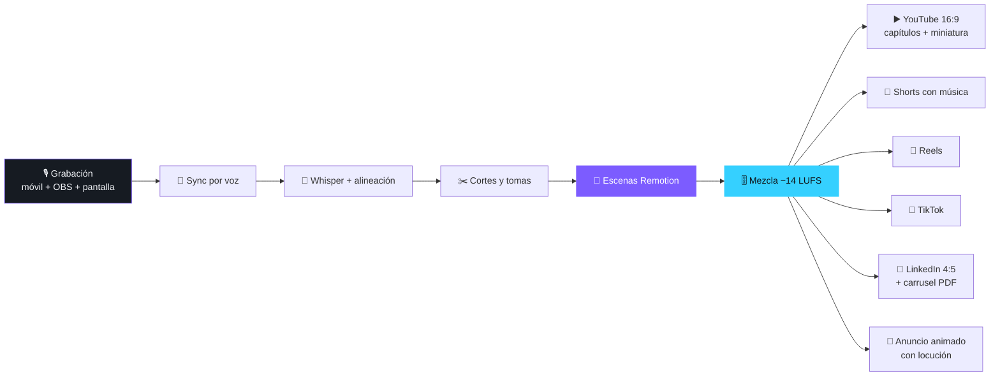

<div align="center">


<a href="#-qué-hace">
  
</a>

<br/>


**Un sistema de edición de vídeo que un agente de IA ejecuta de punta a punta.**<br/>
Tú grabas. Claude Code corta, sincroniza, anima, mezcla, renderiza y te entrega todo listo para publicar.

[⚡ Empezar](#-puesta-en-marcha-en-5-minutos) · [🎬 Qué sale](#-una-grabación-siete-entregables) · [🧩 Escenas](#-catálogo-de-escenas) · [🧠 Por qué funciona](#-el-arma-secreta-reglas-técnicas)

</div>

---

## 🎯 Qué hace

> Abres la carpeta con **Claude Code**, le dices *«edítame el episodio de hoy»* y sigue un manual de producción
> probado en vídeos reales: `CLAUDE.md`. No es un prompt bonito: son **26 scripts**, **más de 30 escenas animadas** y
> **más de 90 reglas técnicas** sacadas de cosas que fallaron de verdad y se arreglaron.

<table>
<tr>
<td width="50%" valign="top">

### ✂️ Edición que no se nota
- Corte de silencios **por energía del audio**, no por los tiempos de Whisper (que mienten)
- Detecta tomas falsas, reinicios y órdenes al editor: *«repetimos desde…»*, *«eso lo cortas»*
- Recupera finales de frase que se comen los cortes automáticos
- **Alineación forzada** (MMS_FA): inicios de palabra sobre la voz del 90,8 % al **99,6 %**

</td>
<td width="50%" valign="top">

### 🎥 Multicámara sin claqueta mágica
- Sincroniza móvil + OBS + pantalla **por correlación de la voz** (±1 ms en pruebas)
- Corrige la cámara frontal en espejo, la rotación y el fps variable del móvil
- Zooms automáticos a lo que se mueve en pantalla
- **Pixelado automático con OCR** de correos, teléfonos, cédulas y datos personales

</td>
</tr>
<tr>
<td width="50%" valign="top">

### ✨ Motion graphics con criterio
- Escenas 3D en Remotion que entran **en la palabra exacta** que se oye
- Titulares **detrás de tu cabeza** (recorte de persona con Robust Video Matting)
- Transición iris desde la cara, punch-in alterno, SFX alineados al fotograma
- Logos automáticos cuando nombras una marca

</td>
<td width="50%" valign="top">

### 📦 Entrega completa
- Montaje final a **−14 LUFS** con capítulos, descripción y miniatura
- Shorts con subtítulos palabra a palabra y zonas seguras de cada app
- Carrusel PDF + post para LinkedIn
- Informe final: qué revisar, créditos gastados y textos listos para pegar

</td>
</tr>
</table>

---

## 🎬 Una grabación, siete entregables



| Entregable | Formato | Detalle |
|---|---|---|
| ▶️ **YouTube** | 1920×1080 · −14 LUFS | Partes montadas, capítulos válidos, descripción con fuentes, miniatura |
| 📱 **YouTube Shorts** | 1080×1920 | Con música, gancho en los primeros 2,8 s |
| 📸 **Instagram Reels** | 1080×1920 | Sin música (la pones al publicar), texto propio |
| 🎵 **TikTok** | 1080×1920 | Sin música, texto propio |
| 💼 **LinkedIn** | 4:5 + PDF + JPG | Vídeo, carrusel, imagen suelta y texto del post |
| 🖼️ **Miniatura** | 16:9 | Imagen generada con tu cara + titular compuesto en Remotion |
| 📣 **Anuncio** | 9:16 y 4:5 | Producto animado en paneles 3D con voz en off sincronizada |

¿No tienes guion? Claude te lo escribe **y te da una guía de grabación paso a paso**.

---

## 🧩 Catálogo de escenas

Escribes un JSON, cada escena se ancla a una frase de la voz, y Remotion hace el resto en **16:9, 9:16 y 4:5**.

<details open>
<summary><b>🎥 Sobre la cámara</b></summary>

| Escena | Para qué |
|---|---|
| `callout` | Frase clave en grande, entra palabra a palabra, *acento* en color |
| `lowerThird` | Nombre y cargo al presentarte |
| `autoLogos` | Ficha con logo cuando nombras una marca |
| `tituloDetras` | Titular gigante **detrás** de tu cabeza |

</details>

<details>
<summary><b>🌌 A pantalla completa (fondo 3D)</b></summary>

| Escena | Para qué |
|---|---|
| `orbOpen` | Esfera de partículas + titular: apertura de capítulo |
| `lineup` | Fichas en fila; apaga la idea que pierde, ilumina la que gana |
| `revealStat` | Cifra gigante + cuadrícula de 100, con fuente en pantalla |
| `bars` · `rise` | Comparativas y curvas que suben |
| `notificacion` | Notificaciones del móvil cayendo: *«mientras no contestas…»* |
| `buscador` | Barra que se escribe sola y despliega resultados |
| `pasos` | Ruta de 2–5 pasos con el activo brillando |
| `comentario` | Chat con «escribiendo…» o comentarios con me gusta |
| `orbChips` · `dissolve` · `broll` · `outro` | Canales orbitando, palabra que se deshace, plano de apoyo, cierre |

</details>

<details>
<summary><b>📣 Anuncios de producto</b></summary>

`apertura` · `canales` · `medianoche` · `chat` · `leads` · `handoff` · `pago` · `listo` · `pildoras` · `hoy` ·
`recupera` · `remate` · `final` — con transición `mancha` (barrido orgánico) y tu app recreada en paneles 3D.
Ejemplo completo en [`videos/ejemplo/anuncio.json`](videos/ejemplo/anuncio.json).

</details>

<details>
<summary><b>🖥️ Grabación de pantalla</b></summary>

`zooms` automáticos y manuales · `showcase` (recorte en grande) · `camFull` (monólogo final) · pixelado por OCR.

</details>

---

## 🏷️ 100 % marca blanca

Ni un nombre, color ni logo fijo en el código. Todo sale de tres archivos:

```
marca/
├── marca.json      🎨 nombre, persona, colores, tipografías
├── canal.json      📺 canal, sitio web, redes
└── proyecto.json   👥 equipo, carpetas, vocabulario para Whisper
```

Cambia `"acento": "#7C5CFF"` por tu color y **todos** los vídeos, shorts, miniaturas y carruseles cambian.

---

## ⚡ Puesta en marcha en 5 minutos

> Probado en **Windows 11 + GPU NVIDIA** (RTX 4060, CUDA 12).

```bash
# 1. Clonar
git clone https://github.com/brianacevedo2001-lab/Skill-Editor-IA.git
cd Skill-Editor-IA

# 2. Python
python -m venv .venv
.venv\Scripts\pip install -r requirements.txt
.venv\Scripts\pip install torch torchaudio torchvision --index-url https://download.pytorch.org/whl/cu128

# 3. ffmpeg y Remotion
winget install Gyan.FFmpeg
cd remotion && npm install && cd ..

# 4. Tu identidad: rellena marca/*.json y pon marca/isotipo.png + marca/logotipo.png
#    (cópialos también a videos/_shared/marca/)

# 5. Librerías de efectos y logos
.venv\Scripts\python pipeline/sfx_generar.py
node remotion/scripts/logos.mjs
```

Y luego:

```bash
claude
> Tengo los brutos del episodio 1 en Drive. Edítalo y sácame los shorts.
```

---

## 🧠 El arma secreta: «Reglas técnicas»

Lo que separa esto de *«un script que corta silencios»* es la sección final de [`CLAUDE.md`](CLAUDE.md): un
registro de **cada cosa que se rompió en producción y cómo se resolvió**. El agente la lee antes de tocar nada.

<table>
<tr><td>🐛</td><td><b>Whisper se salta las repeticiones</b> → segunda pasada trozo a trozo con prompt de titubeos</td></tr>
<tr><td>🐛</td><td><b><code>hotwords</code> hace alucinar</b> «¡Suscríbete al canal!» en los silencios → pasada literal sin hotwords</td></tr>
<tr><td>🐛</td><td><b>Remotion iba a 1/35 del tiempo real</b> en pantalla → render híbrido ffmpeg NVENC + capa de gráficos con alfa</td></tr>
<tr><td>🐛</td><td><b>La voz llegaba 45 ms tarde</b> por el priming del AAC → se mide y se recorta solo</td></tr>
<tr><td>🐛</td><td><b><code>loudnorm linear=true</code> no siempre es lineal</b> → ganancia con <code>volume</code> + limitador de picos</td></tr>
<tr><td>🐛</td><td><b>ffmpeg revienta con 330 tramos</b> → codificación por bloques de 40 + concat sin recodificar</td></tr>
<tr><td>🐛</td><td><b>La cámara frontal graba en espejo</b> (el logo de la sudadera al revés) → <code>hflip</code> en todo el flujo</td></tr>
</table>

Y cuando algo nuevo falla, el agente lo arregla **y lo apunta**. El sistema aprende con cada vídeo.

---

## 🗂️ Estructura

```
📁 marca/       identidad (el único sitio con nombres, colores, logos, redes)
📁 pipeline/    26 scripts Python numerados en el orden del flujo
📁 remotion/    composiciones, escenas, fondos 3D, scripts de QA, logos y láminas
📁 videos/      lo que lee Remotion: guiones JSON, cortes, b-roll, música, logos
📁 raw/         brutos e intermedios pesados (fuera de git)
📁 out/         renders, QA, miniaturas y entregas (fuera de git)
📄 CLAUDE.md    el manual del agente — el cerebro del sistema
```

<details>
<summary><b>🔧 Los scripts del pipeline</b></summary>

| Script | Hace |
|---|---|
| `02_transcribe.py` | faster-whisper en GPU (turbo, ×11,8 tiempo real) con pasada literal |
| `03_tomas.py` | Detecta tomas falsas, reinicios y correcciones habladas |
| `01_cut_silences.py` | Corte por energía con colas suaves y aviso de cortes sobre voz |
| `alinear.py` | Alineación forzada palabra a palabra (MMS_FA) |
| `05_sync.py` | Sincronización de cámaras por correlación de voz |
| `04_grueso.py` · `06_zooms.py` | Bloque de pantalla y zooms automáticos |
| `pixelar_auto.py` · `hojas.py` | Pixelado de datos personales por OCR y hojas de contacto |
| `recortar.py` | Persona con alfa (Robust Video Matting) para capas |
| `lectura.py` · `historial.py` | Ritmo y énfasis de la voz · evita repetir el estilo de vídeos anteriores |
| `golpe_musica.py` | Cuadra la música para que un golpe caiga en el momento clave |
| `render_grueso.py` | Render híbrido ffmpeg + Remotion |
| `verificar_sync.py` · `verificar_corte.py` | QA de cada escena contra su frase + hoja de contactos |
| `07_final.py` | Montaje, −14 LUFS, capítulos, descripción, miniatura |
| `09_shorts.py` · `10_linkedin.py` · `anuncio.py` | Shorts para 3 redes, LinkedIn, anuncios animados |
| `brutos.py` · `drive_api.py` | Traer y entregar desde Google Drive sin colgarse |

</details>

---

## 🔌 Servicios opcionales

Todo funciona en local. Si quieres más, cada servicio va con **tu propia cuenta** (no se incluye ninguna credencial;
`secrets/` está vacía y en `.gitignore`):

| Servicio | Para qué |
|---|---|
| **Higgsfield** (MCP) | B-roll (Kling 3.0), miniaturas, objetos 3D, voz ElevenLabs v4 |
| **HeyGen** (MCP) | Gemelo digital, solo como plan B |
| **Google Drive para escritorio** | Traer brutos y dejar las entregas |
| **Biblioteca de audio de YouTube** | Música sin atribución |

El agente **nunca gasta créditos ni publica sin preguntarte**, y te dice cuánto gastó y cuánto te queda.

---

## 📜 Licencias de terceros

Este proyecto: [MIT](LICENSE). Terceros: [Remotion](https://www.remotion.dev/license) (licencia propia: gratuita para individuos y equipos pequeños) ·
[Robust Video Matting](https://github.com/PeterL1n/RobustVideoMatting) (GPL-3.0, se descarga aparte vía torch.hub) ·
MMS_FA de torchaudio · [Simple Icons](https://simpleicons.org) / Lobe Icons / SVGL para logos.

---

<div align="center">

### ⭐ Si te ahorró una noche de edición, deja una estrella

**Hecho para creadores que prefieren grabar a editar.**


</div>
